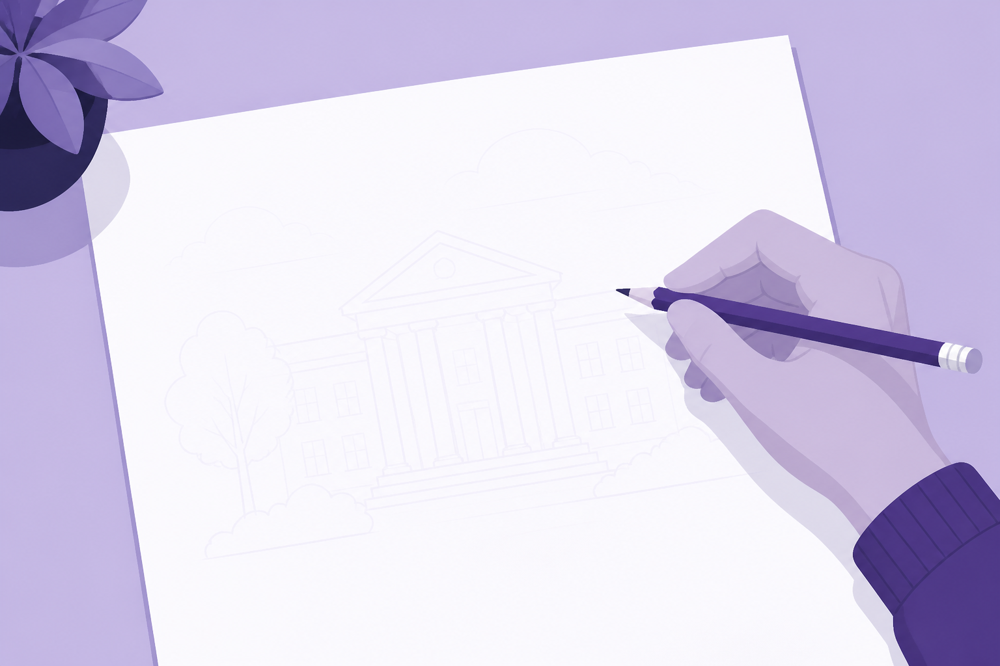

上周我给一屋子大学老师开了个工作坊的头，题目很长：生成式 AI 时代，怎样让教学判断和伦理判断留在人手里。伦理那一半归一位同事，教学这一半归我，我只有十分钟。十分钟说不出什么高明的话，这反倒是好事——它逼着我只讲那些经过两年来工具几个月一换代、我还信的东西。

开场我只问了两个举手就能回答的问题。第一个：最近谁用 AI 设计过课、备过课？第二个：谁心里有一条清楚的规矩，知道什么时候**不**用它？这两个问题中间的那道缝，就是整个题目。我们早就成了熟练的用户，却还没成为有主意的用户。这好比人人都会开车，可问起“什么时候该踩刹车”，大家支支吾吾，说“看情况”。

---

## 一个可以拿自己做的小实验

讲道理之前，我先请大家动手。想象 2045 年大学里的一个小组讨论课，你看见了什么？写下三样东西，四十五秒，写完画一条线。

然后我放出一张 AI 按同样题目画的草图：一张圆桌，桌上飘着一颗全息心脏，有人戴着增强现实眼镜，墙边站着一个憨态可掬的小机器人。再请大家在线下面写三个**新**点子，越跟刚才见过的不一样越好。

屋里的人写了什么，我不打算报告——一屋子人不是一项研究。好在研究是有的。CHI 2024 上有一篇论文做过差不多的实验，六十个人：用 AI 生图来想点子的那组，被它给的头几个例子钉住了，点子更少、花样更少、也更不新鲜。看过一眼草稿，就很难假装没看过。要是你第一轮写的本来就是全息影像和机器人，那也值得留意：AI 的草图，常常不过是我们共同的陈词滥调取了个平均值，再用很笃定的口气端上来。

这让人想起语文课上的老规矩：老师先念一篇范文，全班四十篇作文就都长成了范文的远房亲戚。AI 不过是一个念范文念得特别快的老师。

## 换了好几代，还站得住的四条

工具变得太快，我当天能演示的任何花活，下个月多半就过时了。没变的是下面这四条。

**先想，再问。** 学习目标、课的骨架，自己先定，再把有边界的小活儿交给机器。谁先开口，谁就定了框。这个框最好是你定的。

**用 AI 加深理解，别用它跳过理解。** 设计自己不在行的课时，这一条最要紧——在大学里，这种事比谁都愿意承认的要多。我有一回要给一门不是我本行的课设计活动，没让 AI 写一个字，而是用自己的话把这门课讲给它听，让它挑我的错。讲着讲着，它反过来问我：这些学生学到哪一步了？已经知道什么？自己讲有两个附带的好处：保密的东西一样也没交出去；讲完以后，我能跟课程负责人当同行讨论，而不是递上一份自己都说不清的草稿。也正是这份理解，日后才让你看得出它哪句话说错了。

**AI 起草，人来把关。** 输出再漂亮，也要查：对不对，合不合教学目标，在你的教室里行不行。有个出了名的实验，七百五十八位咨询顾问：在 AI 能力范围以内的任务上，用 AI 又快又好；可在刚刚越出它能力的任务上，用 AI 的人答对的可能反而低了十九个百分点。那条边界，在输出里是看不出来的。写得漂亮不算证据。

**自动化放大不了责任，只会把它推回来。** AI 写了个病例，专家改了几处，错误还是到了学生手里——课是我们的，名字也是我们的。Madeleine Elish 管这叫“道德缓冲区”：自动化系统出了事，挨撞的总是离得最近的那个人。在课堂上，离得最近的那个人就是老师。

## 带走一句话

十分钟要是只能压成一句，就是：AI 会放大清晰，但不会制造清晰。清楚这节课为什么上的老师，能从机器那里拿到一节更好的课；不清楚的，只会拿到一个非常自信的平均数。

这是教学那一面。一个设计在这一面过了关，照样可能在偏见、伤害、代价由谁承担这些事上出问题——所以那天还有下半场，而我很庆幸，不是我一个人讲。
