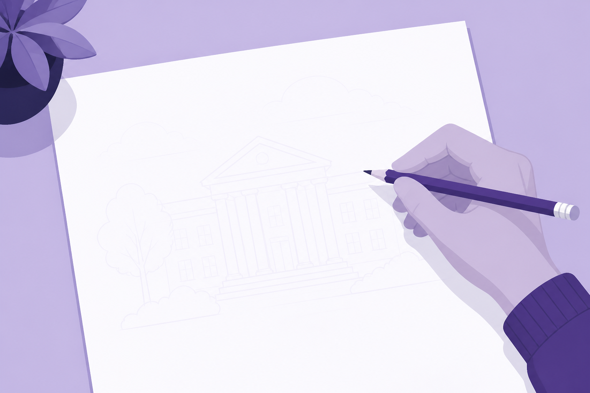

Vorige week opende ik samen met een collega een workshop voor universitaire docenten over hoe je het pedagogisch en ethisch oordeel bij de mens houdt in een tijd van generatieve AI. Mijn deel ging over het pedagogische oordeel en duurde tien minuten. Dat is kort, en daardoor moest ik kiezen: wat blijft overeind, terwijl de tools elke paar maanden veranderen?

Ik begon met twee vragen. Wie heeft onlangs AI gebruikt om onderwijs te ontwerpen? En wie heeft een duidelijke regel voor wanneer je AI *niet* gebruikt? Tussen die twee vragen zit het onderwerp. We gebruiken AI al veel, maar nog zelden bewust.

---

## Een korte proef

Ik vroeg de deelnemers zich een werkgroep in 2045 voor te stellen en in 45 seconden drie dingen op te schrijven. Daarna liet ik een schets zien die een AI bij dezelfde opdracht had gemaakt, met een hologram, AR-brillen en een kleine robot, en vroeg ik om drie nieuwe ideeën die daar zo ver mogelijk van afweken.

Wat de zaal opschreef, laat ik hier buiten beschouwing; één zaal is geen onderzoek. Maar er is onderzoek. In een studie die op CHI 2024 werd gepresenteerd, kwamen deelnemers die ideeën bedachten met een AI-beeldgenerator met minder, minder gevarieerde en minder originele ideeën dan deelnemers zonder AI. Ze bleven hangen aan de eerste voorbeelden. Wie eenmaal een concept heeft gezien, krijgt het moeilijk weer uit zijn hoofd.

## Vier principes die standhouden

1. **Eerst denken, dan prompten.** Bepaal zelf de leerdoelen en de opzet van de sessie. Geef AI daarna afgebakende taken. Wie als eerste spreekt, bepaalt het kader.
2. **Gebruik AI om beter te begrijpen, niet om begrijpen over te slaan.** Dat geldt vooral als je buiten je eigen vakgebied ontwerpt. Toen ik een activiteit moest ontwerpen voor een vak buiten mijn expertise, legde ik het vak in mijn eigen woorden aan de AI uit en liet ik me corrigeren. Zo ging er geen vertrouwelijke informatie naar de tool, en kon ik daarna als gelijkwaardige gesprekspartner met de vakcoördinator praten.
3. **AI maakt het concept, de mens beoordeelt.** In een experiment met 758 consultants werkten mensen met AI sneller en beter bij taken binnen de mogelijkheden van het systeem. Bij een taak net daarbuiten hadden ze negentien procentpunten minder kans op een juist antwoord. Die grens zie je niet aan de output.
4. **Verantwoordelijkheid schaalt niet mee met automatisering.** Als er een fout bij studenten terechtkomt, is het nog steeds ons vak en onze naam. Madeleine Elish noemt dit de *moral crumple zone*: bij falen komt de verantwoordelijkheid terecht bij de mens die het dichtst bij staat.

## Samengevat

AI versterkt helderheid, maar creëert die niet. Die helderheid moet van de docent komen. Daarna komt de tweede vraag, de ethische: welke aannames, risico's en kosten zitten er in het ontwerp, en wie draagt die? Dat was het deel van mijn collega, en het hoort er net zo goed bij.
