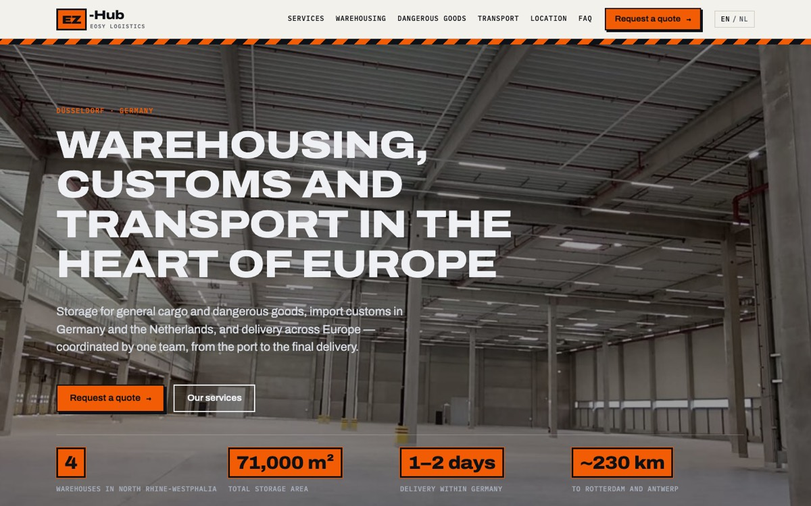
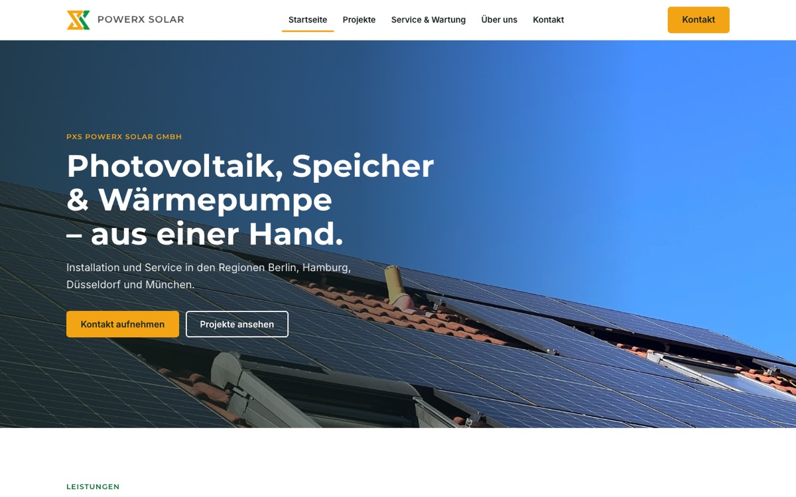
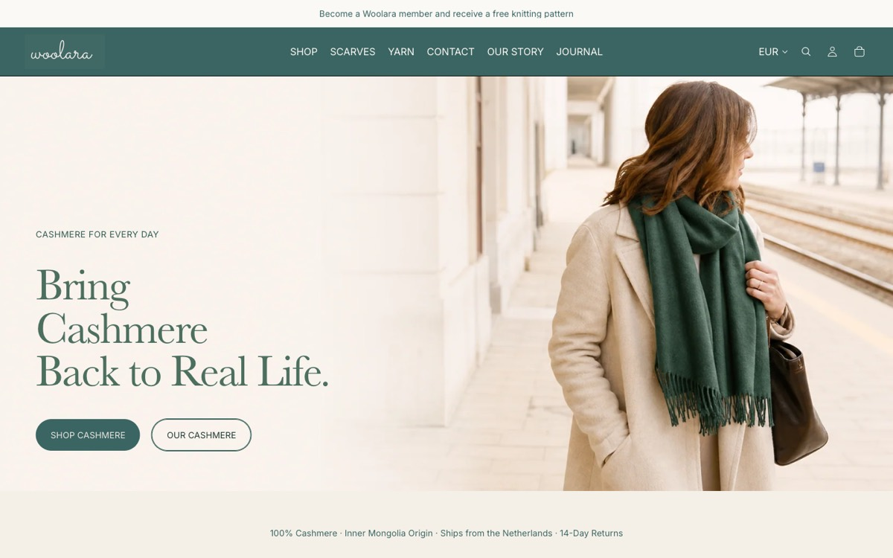
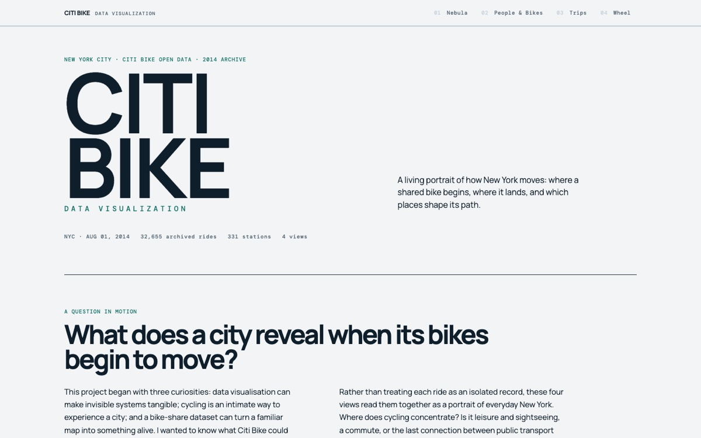
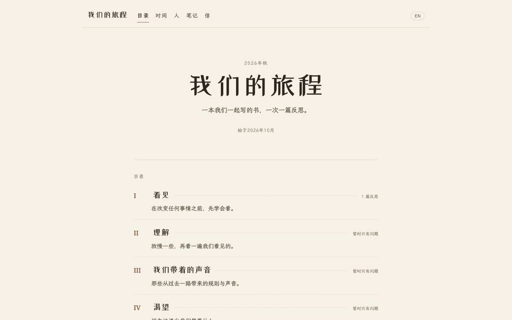
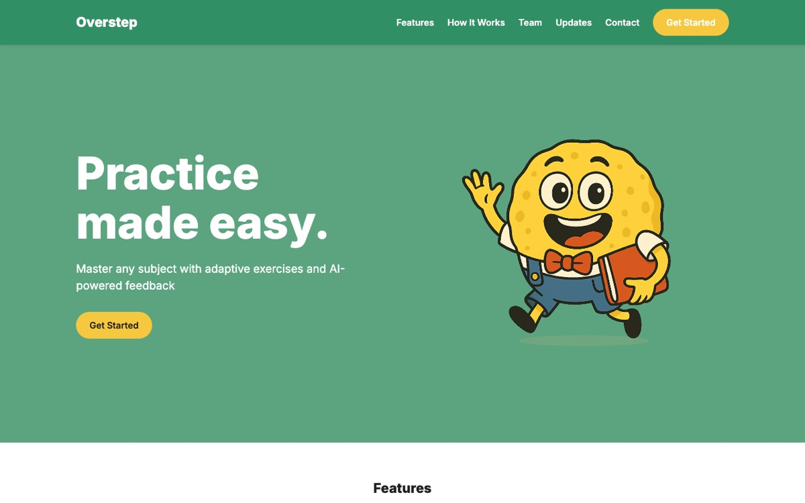

从 2013 年起我就在做网站：先是手写，后来用 GitHub Pages，现在是 WordPress 上范围固定的小型客户项目。这一页把它们收在一起：每个网站是什么、我做了什么、在哪里能看到。

## {{page.title}}
-----

### EZ-Hub（Eosy Logistics）· 2026

杜塞尔多夫一家仓储、清关与运输公司（含持证危险品仓储）的英语 / 荷兰语单页网站。自己写的 WordPress 主题，以 ADR 危险品橙色标牌为视觉核心，带询价表单和区域示意地图，不用 cookie、不做追踪。从规划、设计到上线只用了一天，用的是客户已有的主机。

[ez-hub.com](https://ez-hub.com)

### PowerX Solar · 2026

一家光伏、储能和热泵安装公司的德语 WordPress 网站。固定价格的客户项目：书面范围、自写主题和内容插件、四种屏幕尺寸的自动化验收测试，交付后客户不碰代码就能改所有内容。

[powerxsolar.de](https://powerxsolar.de)（新站 2026 年 11 月底上线）

### Woolara · 2025

一个内蒙古羊绒品牌的网站。第一版是我用 Jekyll 在 GitHub Pages 上搭的：每种毛线一个产品页、品牌故事、联系表单；现在品牌方把它做成了网店。

[woolara.eu](https://www.woolara.eu) · [GitHub](https://github.com/li6834300/Woolara)

### Citi Bike 数据可视化 · 2026

用 D3 和 Leaflet 做的四个交互视图，展示 2014 年某一天纽约 Citi Bike 的 32,655 次骑行记录。

[网站](https://lizhien.me/citi-bike-data-visualization/) · [GitHub](https://github.com/li6834300/citi-bike-data-visualization)

### 我们的旅程（Journey Book）· 2026

一本两个人一起写的书：内容是放在 Git 仓库里的 Markdown，用一个小小的 React + Vite 网站以中英文阅读。

[网站](https://lizhien.me/journey-book/) · [GitHub](https://github.com/li6834300/journey-book)

### Overstep 落地页 · 2025

我的自适应练习学习应用 Overstep 的落地页。

[网站](https://lizhien.me/overstep-landing/) · [关于这个应用](/overstep/)

### 早期作品 · 2013–2017

* [Web Dev @ Citi](/citibank/) —— 为花旗市场与媒体传播部门做的迷你站、邮件简报和网页内容。
* [See Film LC](/seefilm/) —— 一家影视制作初创公司的落地网站。
* [我的婚礼网站](/wedding/) —— 用 Bootstrap 做的，带宾客登记、请柬和相册。
* [玩转 GitHub Pages](/having-fun-with-github-pages/) —— 一年里用 GitHub Pages 和 Jekyll 搭了四个网站。
* [旧作品集网站](/old-personal-website/) —— 我第一个独立设计和编码的网站。
