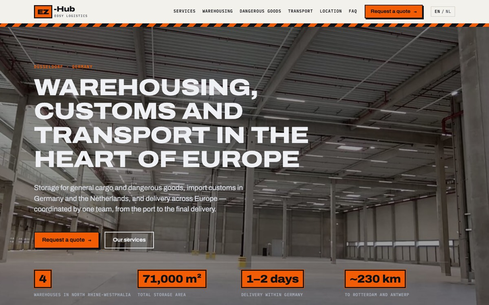
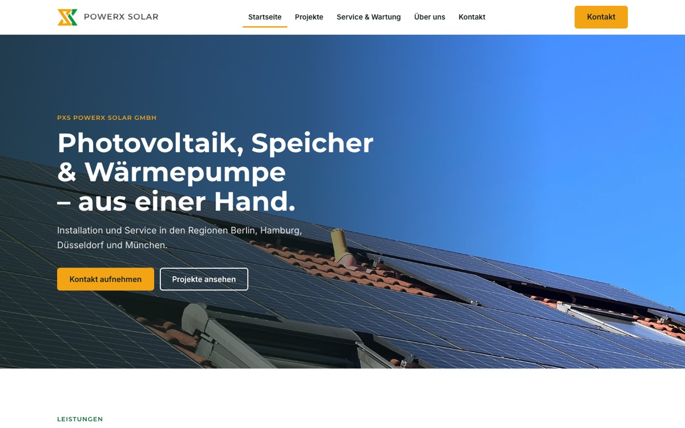
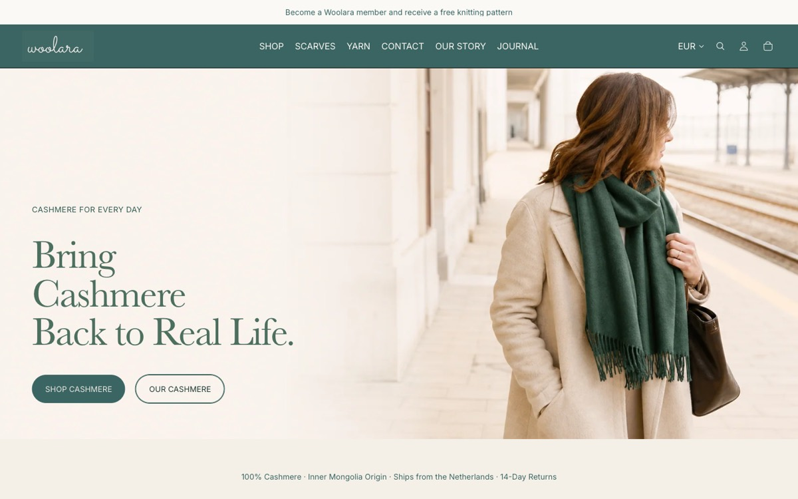
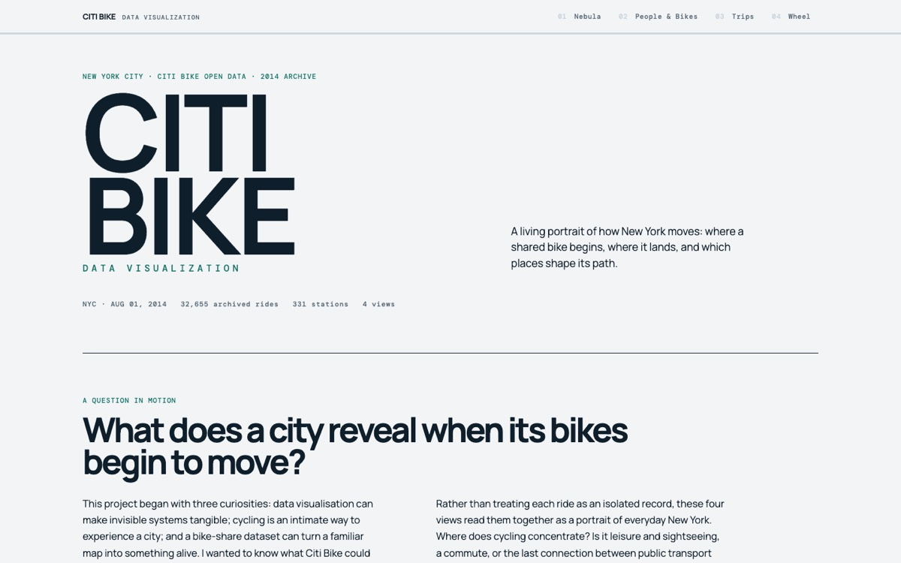
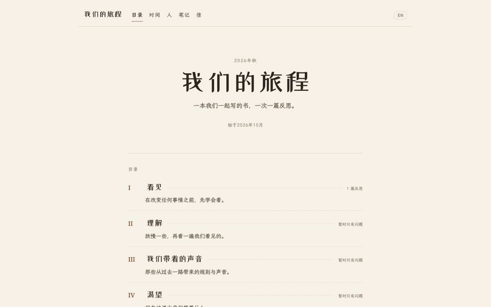
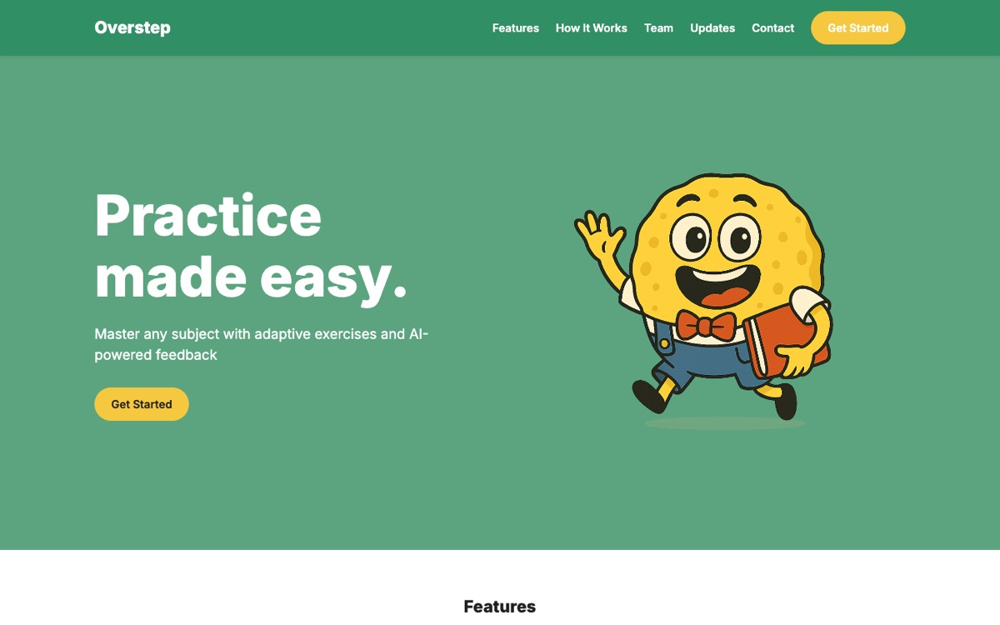

I have been building websites since 2013 — first by hand, then on GitHub Pages, and now as small, fixed-scope client projects on WordPress. This page collects them in one place: what each site is, what I did, and where to see it.

## {{page.title}}
-----

### EZ-Hub (Eosy Logistics) · 2026

A bilingual (English / Dutch) one-page site for a warehousing, customs and transport company in Düsseldorf, including licensed storage for dangerous goods. My own WordPress theme with an industrial look built around the orange ADR hazard plate, a quote form, a schematic map of the region, and no cookies or tracking at all. Planned, designed and launched in a single day, on hosting the client already had.

[ez-hub.eu](https://ez-hub.eu)

### PowerX Solar · 2026

A German-language WordPress site for a solar, battery-storage and heat-pump installer — a fixed-price client project with a written scope, a custom theme and content plugin, automated acceptance tests at four screen sizes, and a handover so the client edits everything without touching code.

[powerxsolar.de](https://powerxsolar.de) (new site goes live in late November 2026)

### Woolara · 2025

A brand website for a cashmere label sourcing from Inner Mongolia. I built the first version as a Jekyll site on GitHub Pages — product pages per yarn, a brand story, a contact form; the brand now runs it as an online store.

[woolara.eu](https://www.woolara.eu) · [GitHub](https://github.com/li6834300/Woolara)

### Citi Bike Data Visualization · 2026

Four interactive views of 32,655 archived New York Citi Bike rides from one day in 2014, built with D3 and Leaflet.

[Live site](https://lizhien.me/citi-bike-data-visualization/) · [GitHub](https://github.com/li6834300/citi-bike-data-visualization)

### Journey Book · 2026

A book two people write together: plain Markdown in a Git repository, read through a small React + Vite website in Chinese and English.

[Live site](https://lizhien.me/journey-book/) · [GitHub](https://github.com/li6834300/journey-book)

### Overstep landing page · 2025

The landing page for Overstep, my adaptive-practice learning app.

[Live site](https://lizhien.me/overstep-landing/) · [About the app](/overstep/)

### Earlier work · 2013–2017

* [Web Dev @ Citi](/citibank/) — mini-sites, newsletters and web content for Citi's marketing and media communication department.
* [See Film LC](/seefilm/) — landing website for a film-production start-up.
* [My Marriage Website](/wedding/) — Bootstrap site with guest registration, invitations and photos.
* [Having Fun With GitHub Pages](/having-fun-with-github-pages/) — four sites in one year on GitHub Pages and Jekyll.
* [Old Portfolio Site](/old-personal-website/) — the first site I designed and coded on my own.
