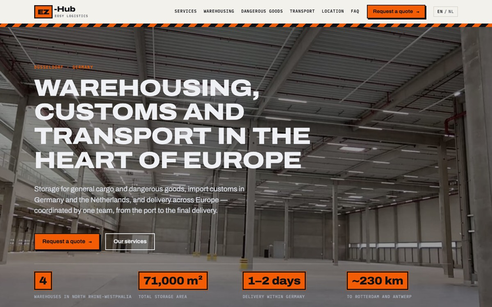
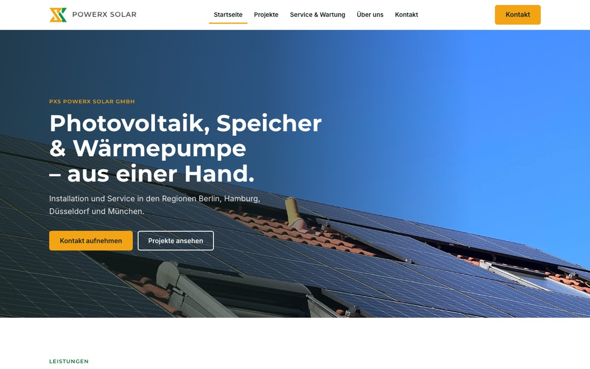
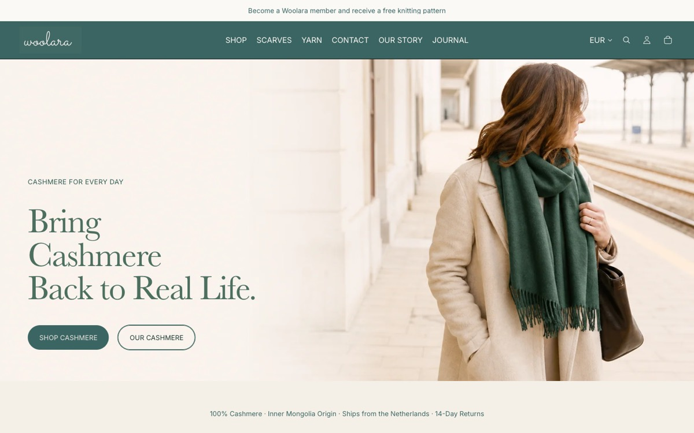
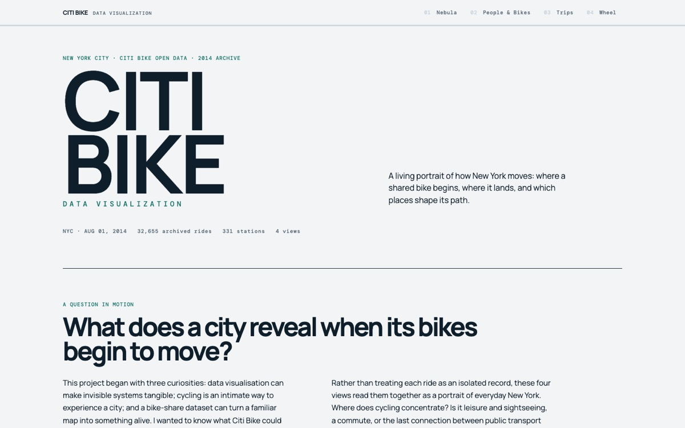
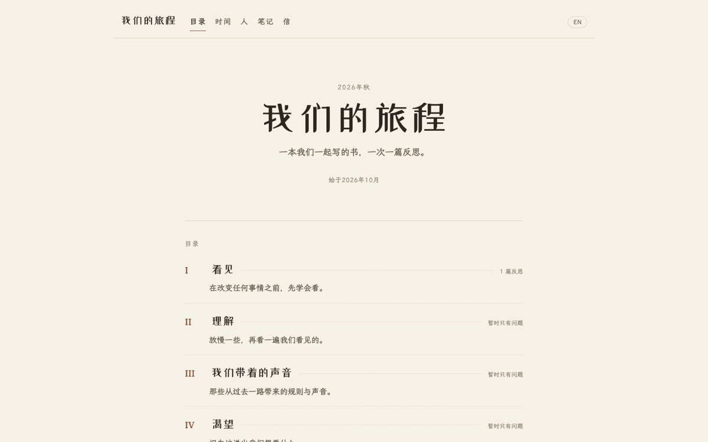
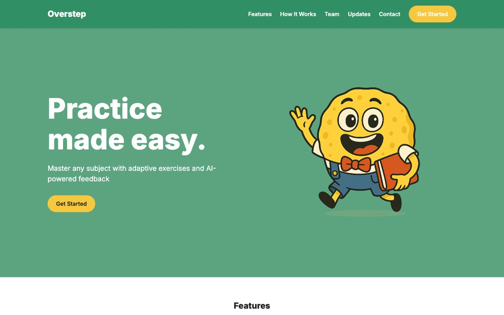

Sinds 2013 bouw ik websites: eerst met de hand, daarna op GitHub Pages en nu als kleine klantprojecten met een vaste scope op WordPress. Op deze pagina staan ze bij elkaar: wat elke site is, wat ik deed en waar je hem kunt bekijken.

## {{page.title}}
-----

### EZ-Hub (Eosy Logistics) · 2026

Een tweetalige (Engels / Nederlands) one-pager voor een bedrijf in opslag, douane en transport in Düsseldorf, inclusief vergunde opslag van gevaarlijke stoffen. Een eigen WordPress-thema met een industriële stijl rond het oranje ADR-bord, een offerteformulier, een schematische kaart van de regio en geen cookies of tracking. Gepland, ontworpen en live gezet op één dag, op hosting die de klant al had.

[ez-hub.com](https://ez-hub.com)

### PowerX Solar · 2026

Een Duitstalige WordPress-site voor een installateur van zonnepanelen, thuisbatterijen en warmtepompen. Een klantproject tegen een vaste prijs: schriftelijke scope, eigen thema en contentplugin, geautomatiseerde acceptatietests op vier schermformaten, en een overdracht waarna de klant alles zelf aanpast zonder code.

[powerxsolar.de](https://powerxsolar.de) (de nieuwe site gaat eind november 2026 live)

### Woolara · 2025

Een merkwebsite voor een kasjmiermerk uit Binnen-Mongolië. De eerste versie bouwde ik als Jekyll-site op GitHub Pages: een productpagina per garen, het merkverhaal en een contactformulier; inmiddels draait het merk er een webwinkel op.

[woolara.eu](https://www.woolara.eu) · [GitHub](https://github.com/li6834300/Woolara)

### Citi Bike-datavisualisatie · 2026

Vier interactieve weergaven van 32.655 gearchiveerde Citi Bike-ritten in New York op één dag in 2014, gebouwd met D3 en Leaflet.

[Website](https://lizhien.me/citi-bike-data-visualization/) · [GitHub](https://github.com/li6834300/citi-bike-data-visualization)

### Journey Book · 2026

Een boek dat twee mensen samen schrijven: gewone Markdown in een Git-repository, te lezen via een kleine React + Vite-website in het Chinees en Engels.

[Website](https://lizhien.me/journey-book/) · [GitHub](https://github.com/li6834300/journey-book)

### Overstep-landingspagina · 2025

De landingspagina van Overstep, mijn leerapp voor adaptief oefenen.

[Website](https://lizhien.me/overstep-landing/) · [Over de app](/overstep/)

### Eerder werk · 2013–2017

* [Web Dev @ Citi](/citibank/) — minisites, nieuwsbrieven en webcontent voor de marketing- en communicatieafdeling van Citi.
* [See Film LC](/seefilm/) — landingswebsite voor een filmproductie-start-up.
* [Mijn trouwwebsite](/wedding/) — Bootstrap-site met gastenregistratie, uitnodigingen en foto's.
* [Spelen met GitHub Pages](/having-fun-with-github-pages/) — vier sites in één jaar met GitHub Pages en Jekyll.
* [Oude portfoliosite](/old-personal-website/) — de eerste site die ik zelf ontwierp en codeerde.
